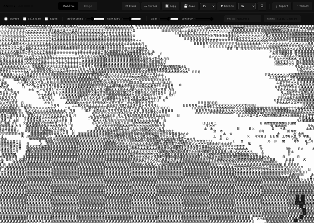

<h1>ASCII Studio</h1>

Turn your webcam into real-time ASCII art. 
A small experiment that runs entirely in your browser.

  
  
  

<a href="https://ascii.santiagoalonso.com">Try it live</a>

ASCII Studio redraws your camera feed, or any image, as text characters while you watch.

- 30 character sets, from classic ASCII to Japanese, Braille and zodiac signs.
- 8 color themes and effects like edge detection, solarize and invert.
- Save a PNG, record a video, or copy the text.

## How it works

Open the page, allow camera access and play with the settings. The video stays in your browser; nothing is uploaded. Shortcuts: `[` and `]` change the style, `,` and `.` the theme, `Space` pauses, `M` mirrors, `C` copies, `S` saves, `R` records and `F` goes fullscreen.

## Install

Nothing to install: use it at [ascii.santiagoalonso.com](https://ascii.santiagoalonso.com), or open `index.html` in a browser.

---

[MIT](LICENSE)

Made by [santiagoalonso.com](https://santiagoalonso.com)
